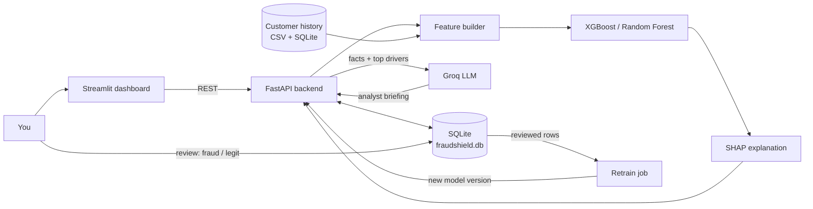

# 🛡️ FraudShield

**Explainable transaction fraud detection** with a FastAPI backend, a Streamlit dashboard, SQLite storage, AI-written analyst briefings (Groq), and in-app model retraining from transactions you review.

Type in a transaction → get a fraud verdict, a risk level and the reasons behind it → confirm whether it was really fraud → retrain the model on your own confirmed cases.

---

## Contents

- [Features](#features)
- [How it works](#how-it-works)
- [Quick start](#quick-start)
- [Using the app](#using-the-app)
- [Retraining, explained](#retraining-explained)
- [The model](#the-model)
- [Dataset](#dataset)
- [Project structure](#project-structure)
- [API reference](#api-reference)
- [Configuration](#configuration)
- [Rebuilding the ML pipeline](#rebuilding-the-ml-pipeline)
- [Known limitations](#known-limitations)
- [Troubleshooting](#troubleshooting)

---

## Features

| | |
|---|---|
| 🔍 **Fraud check** | Enter a transaction by hand (no payment gateway needed) and get a fraud probability, a verdict, a risk level and a recommended action |
| 🧠 **Explainable** | Top SHAP drivers shown as plain-English reasons ("Amount is 8.2x this customer's usual spend") and a colored impact chart |
| 🤖 **AI recommendations** | A Groq-hosted LLM writes a short analyst briefing: why it was flagged, what to check next, what to do, and a draft message to the customer |
| 🗄️ **SQLite storage** | Every saved transaction keeps its features, prediction, AI text and review label; saved transactions also become part of the customer's history |
| 🧑‍⚖️ **Human review** | Mark transactions as confirmed fraud / confirmed legit; this is the ground truth for retraining |
| 🔁 **Retrain in the UI** | Train on the original data plus your reviewed rows, compare old vs new on a fixed benchmark, then activate or roll back any version |
| 📦 **Batch scoring** | Upload a CSV (optionally with a `label` column) or sample the held-out test set |
| 📊 **Dashboards** | Fraud by type, channel, day and currency; model metrics; per-customer 360 view |
| 🔌 **REST API** | Everything the dashboard does is available through documented endpoints |

### Risk levels

| Level | Condition | Recommended action |
|---|---|---|
| 🟢 LOW | probability < ½ × threshold | Approve |
| 🟡 MEDIUM | below threshold | Approve with step-up authentication (OTP / biometric) |
| 🟠 HIGH | ≥ threshold, < 0.85 | Hold and send for analyst review |
| 🔴 CRITICAL | ≥ 0.85 | Block and contact the customer |

---

## How it works



The backend rebuilds, for one new transaction, the **same 22 engineered features** the training pipeline creates (distance from home, device change, velocity, spending baseline, new payee/merchant, unusual hour, …) using only the customer's *earlier* history, so inference matches training.

**Tech stack:** Python · FastAPI · Streamlit · scikit-learn · XGBoost · SHAP · pandas · SQLite · Groq API (plain `requests`)

---

## Quick start

**Requirements:** Python 3.10 or newer.

### 1. Install

From the `FraudShield/` folder:

```bash
# create and activate a virtual environment
python -m venv .venv
.venv\Scripts\activate          # Windows
# source .venv/bin/activate     # macOS / Linux

pip install -r requirements.txt
```

### 2. Train the model (once)

```bash
python modules/model.py
```

This creates `models/fraud_model.pkl`. The API will not start without it. (`models/` is git-ignored, so everyone who clones the repo trains their own.)

### 3. Add your Groq key (optional but recommended)

Copy `.env.example` to `.env` and set your key from <https://console.groq.com/keys>:

```env
GROQ_API_KEY=gsk_your_key_here
```

Without a key everything works except the AI recommendations.

### 4. Run it

Open **two terminals** in the `FraudShield/` folder (activate the virtual environment in each).

```bash
# Terminal 1 - API   (wait for "Application startup complete")
uvicorn backend.api:app --port 8000
```

```bash
# Terminal 2 - Dashboard
streamlit run frontend/app.py
```

- Dashboard: <http://localhost:8501>
- API docs (Swagger): <http://127.0.0.1:8000/docs>

On first start the API creates `data/fraudshield.db` and registers your current model as version `v0`.

---

## Using the app

| Tab | What you do there |
|---|---|
| **🔍 Check Transaction** | Pick a customer, use a quick scenario (everyday purchase, account takeover, money-mule transfer, card-not-present abroad) or fill in the form, then **Analyze**. See the verdict, reasons, AI briefing, and confirm fraud / legit. |
| **📦 Batch Scoring** | Upload a CSV (template provided) or score a sample of the test set. A `label` column (1 = fraud, 0 = legit) saves rows as already reviewed. |
| **🗂️ Transactions** | Browse saved transactions, filter by verdict or review status, open one to read the explanation, regenerate the AI briefing, set or clear your verdict, or delete it. |
| **🔁 Retrain** | See how much reviewed data you have, retrain, compare old vs new, activate a version or switch back. |
| **📊 Dashboard** | Your saved-transaction stats (including model false alarms and missed fraud) plus the original dataset's fraud patterns. |
| **🧠 Model Insights** | Test metrics, model comparison, SHAP feature importance and evaluation charts. |
| **👤 Customer 360** | A customer's baseline, known payees/merchants, usual hours, home location and recent transactions. |

**Typical first session:** analyze ~10 transactions with **Save to database** ticked → click *It's fraud* / *It's legit* on each → open **Retrain** → **Retrain model** → read the comparison → **Activate**.

---

## Retraining, explained

- **Training data = original dataset + every transaction you reviewed.**
- **Unreviewed transactions are never used.** The model's own predictions are not ground truth; training on them would just reinforce its mistakes.
- Your reviewed rows can be **up-weighted** (default ×3, adjustable) because there are few compared with the 40,000 original rows.
- A stratified **25% of your reviewed rows is held out**, so you can see how the old and new models do on data neither trained on.
- The **original test set stays untouched** as a fixed benchmark. A new model is only *recommended* if it does not regress there (PR-AUC, recall and precision tolerances are checked).
- A retrained model is saved as a **new version** and does **not** replace the active one until you activate it. You can switch back to any earlier version at any time. Optionally, tick *activate automatically if there is no regression*.
- The retrain uses the same preprocessing, estimator family and hyper-parameters as the active model, the same chronological validation split, and the same F1-optimal threshold rule as `modules/model.py`.
- If you re-run `modules/model.py` yourself, the API detects the replaced model file at startup and registers it as a new version.

> With only a few dozen reviewed rows the retrained model will barely differ from the original. The more (and more varied) your reviews, the more it can adapt.

---

## The model

**22 features**, in two groups:

| Group | Features |
|---|---|
| **Transaction** | `amount`, `card_present`, `is_international`, `transaction_hour`, `transaction_day`, `is_weekend`, `account_age_days` |
| **Personalized (from the customer's own history)** | `distance_from_home_km`, `device_change`, `transactions_last_1h`, `transactions_last_24h`, `failed_attempts_24h`, `customer_prior_transaction_count`, `customer_avg_amount_prior`, `customer_std_amount_prior`, `amount_deviation_ratio`, `unusual_transaction_time`, `new_merchant_for_customer`, `new_payee`, `has_time_history`, `has_merchant_history`, `has_payee_history` |

Four models are compared (XGBoost and Random Forest, each with basic-only and with personalized features); the best one on validation is saved with a threshold tuned for the best F1 score.

**Result of the saved model (XGBoost – Personalized) on the held-out test set** (10,000 transactions, 360 fraud):

| Precision | Recall | F1 | PR-AUC | False positives | False negatives |
|---|---|---|---|---|---|
| 0.984 | 1.000 | 0.992 | 0.999 | 6 | 0 |

Personalized features outperform basic-only features (see `data/fraud_intelligence/ablation_reports/` and `model_reports/model_comparison.csv`). Merchant category and payment type are stored and shown to the AI, but are not model features.

---

## Dataset

A **synthetic** dataset of 50,000 transactions (`data/FraudShield_Dataset.xlsx`), cleaned into `data/processed_data.csv`:

- 5,000 customers · 20 May 2026 → 15 Nov 2026 · **3.5% fraud** (1,750 cases)
- Fraud types: **CNP** (card-not-present, 650) · **ATO** (account takeover, 600) · **MONEY_MULE** (500)
- Channels: UPI, Debit Card, Credit Card, NetBanking, Wallet
- Currencies: INR (94%), USD, EUR, GBP, AED, SGD
- Split chronologically: the first 40,000 transactions are train (75%) / validation (25%); the last 10,000 are the test set.

---

## Project structure

```
FraudShield/
├── backend/
│   ├── api.py            FastAPI app: scoring, feature builder, SHAP, endpoints, retrain job
│   ├── db.py             SQLite layer (transactions, customers, model versions)
│   ├── llm.py            Groq client and the analyst-briefing prompt
│   └── retrain.py        Retraining + old-vs-new comparison
├── frontend/
│   └── app.py            Streamlit dashboard
├── modules/              ML pipeline (run once, in order - see below)
│   ├── data_processing.py
│   ├── analysis.py
│   ├── feature_engineering.py
│   ├── fraud_intelligence.py
│   ├── ablation.py
│   ├── model.py
│   └── explainability.py
├── data/
│   ├── FraudShield_Dataset.xlsx     raw dataset
│   ├── processed_data.csv           cleaned data (also the customer-history source)
│   ├── fraud_intelligence/          reports, train/test split, model reports
│   ├── explainability/              SHAP outputs
│   ├── analysis/                    exploratory charts
│   └── fraudshield.db               created at first run (your saved transactions)
├── models/
│   ├── fraud_model.pkl              the active model (created by model.py)
│   └── versions/                    every model version (created at first run)
├── requirements.txt
├── .env.example
└── README.md
```

### SQLite tables (`data/fraudshield.db`)

| Table | Holds |
|---|---|
| `transactions` | Raw fields, the exact features the model saw, prediction, risk level, SHAP reasons, AI briefing, **review label**, and which model version last trained on it |
| `customers` | Profiles of customers that were not in the original CSV |
| `model_versions` | Registry of model versions: metrics, threshold, source, active flag |

---

## API reference

Interactive docs at `/docs`. Main endpoints:

| Method & path | Purpose |
|---|---|
| `POST /predict` | Score one transaction. Query: `ai=never\|flagged\|always`, `ai_model=<groq model>` |
| `POST /predict/batch` | Score up to 2,000 transactions (processed in time order) |
| `GET /transactions` | List saved transactions (filters: `flagged`, `review`, `customer`, paging) |
| `GET /transactions/{id}` | Full detail incl. features, reasons, AI text |
| `POST /transactions/{id}/review` | Set `label` 1 / 0 (or `null` to clear) and an optional note |
| `POST /transactions/{id}/ai` | (Re)generate the Groq briefing |
| `DELETE /transactions/{id}` | Delete (also removed from the customer's history) |
| `GET /db/stats` | Saved / flagged / reviewed counts |
| `GET /ai/status`, `GET /ai/models` | Whether a Groq key is configured; live Groq model list |
| `GET /retrain/status` · `POST /retrain` | Retrain job status · start a retrain |
| `GET /models/versions` · `POST /models/versions/{v}/activate` | Version registry · activate / roll back |
| `GET /customers`, `GET /customers/{id}` | Customer list and profile |
| `GET /analytics/summary`, `GET /predictions/recent` | Dashboard data |
| `GET /model/info`, `GET /health` | Metrics and feature importance · health check |

### Example

```bash
curl -X POST http://127.0.0.1:8000/predict \
  -H "Content-Type: application/json" \
  -d '{
    "customer_id": "CUST04051",
    "amount": 95000,
    "currency": "INR",
    "timestamp": "2026-11-22T03:10:00",
    "payee_id": "PAY_NEW_1",
    "device_id": "DEV_NEW_1",
    "transaction_type": "UPI",
    "card_present": 0,
    "is_international": 0,
    "transaction_latitude": 28.61,
    "transaction_longitude": 77.21,
    "persist": false
  }'
```

Response (shortened; exact numbers depend on your trained model):

```json
{
  "fraud_probability": 0.9999,
  "is_fraud": true,
  "risk_level": "CRITICAL",
  "recommended_action": "Block transaction and contact the customer",
  "reasons": [
    {"label": "Transaction amount", "direction": "increases_risk",
     "text": "Amount is 95,000.00 INR."},
    {"label": "Distance from home (km)", "direction": "increases_risk",
     "text": "Transaction happened 2,073 km from the registered home location."},
    {"label": "Device changed", "direction": "increases_risk",
     "text": "A different device than the customer's previous transaction."}
  ]
}
```

Scoring a customer that is not in the dataset requires `customer_registered_latitude`, `customer_registered_longitude` and `account_creation_date` in the request.

---

## Configuration

Settings live in a `.env` file in the `FraudShield/` folder (never commit it; `.gitignore` already excludes it). Restart the API after changing it.

| Variable | Purpose | Default |
|---|---|---|
| `GROQ_API_KEY` | Your Groq key, enables AI recommendations | – |
| `GROQ_MODEL` | Default Groq model id (the sidebar can load the live list and override per session) | `llama-3.3-70b-versatile` |
| `FRAUDSHIELD_API_URL` | Used by the dashboard if the API is not on the default address | `http://127.0.0.1:8000` |
| `FRAUDSHIELD_API_KEY` | Protect the API: every request must send header `X-API-Key` | off |
| `FRAUDSHIELD_CORS` | Allowed origins, comma-separated | `*` |
| `FRAUDSHIELD_DB` | Custom SQLite file path | `data/fraudshield.db` |

**Suggested `.gitignore` additions:** `data/fraudshield.db*` and `models/versions/`.

To reset all saved transactions and model versions: stop the API and delete `data/fraudshield.db*` and `models/versions/`. Your original data and `fraud_model.pkl` are not affected.

---

## Rebuilding the ML pipeline

You only need this if you change the raw dataset or the features. Run from the `FraudShield/` folder, in this order:

| # | Command | Produces |
|---|---|---|
| 1 | `python modules/data_processing.py` | Validates and cleans the Excel file → `processed_data.csv`, `rejected_records.csv`, `error_report.csv` |
| 2 | `python modules/analysis.py` *(optional)* | Exploratory charts in `data/analysis/` |
| 3 | `python modules/feature_engineering.py` | `feature_engineered_data.csv` |
| 4 | `python modules/fraud_intelligence.py` | Fraud-pattern reports, `train_data.csv` / `test_data.csv`, synthetic-data warnings |
| 5 | `python modules/ablation.py` *(optional)* | Feature-ablation study |
| 6 | `python modules/model.py` | Trains and compares models → `models/fraud_model.pkl`, `model_reports/` |
| 7 | `python modules/explainability.py` *(optional)* | SHAP charts and `feature_importance.csv` |

---

## Known limitations

- **The data is synthetic and very separable.** `fraud_intelligence/synthetic_data_warnings.csv` shows some distance bands with a 100% fraud rate, and test scores are near-perfect. Real-world performance will be lower; treat the metrics as a demonstration of the pipeline, not a production benchmark.
- **`amount` dominates** the model's decisions (by far the largest mean |SHAP|), and amounts of different currencies are used as-is rather than converted to a single currency.
- **Retraining on a handful of reviews barely moves the model**, and the original test set cannot show improvement because it is already near-perfect; it mainly guards against regressions.
- **The Groq integration depends on your key and on Groq's model availability.** Model names change, so use *Load models from Groq* in the sidebar if the default is rejected.
- **AI briefings are summaries of the model's output**, not independent investigations or final decisions.
- **Velocity features need recent history.** A transaction timestamped *now* sees little recent history for the original customers (the dataset ends in Nov 2026), so the "last 1h / 24h" counts are usually 0 unless you back-date the transaction or save several in a row.
- There is no authentication or user management in the dashboard, and no automated test suite is included.

---

## Troubleshooting

| Problem | Fix |
|---|---|
| "Cannot reach the API" in the dashboard | Start the API first and wait for `Application startup complete` |
| `Model not found at …fraud_model.pkl` | Run `python modules/model.py` |
| `ModuleNotFoundError: backend` | Run `uvicorn` from the `FraudShield/` folder, not from inside `backend/` |
| Port 8000 already in use | Start with `--port 8001` and set `FRAUDSHIELD_API_URL=http://127.0.0.1:8001` in `.env` |
| Sidebar says AI recommendations are off | Add `GROQ_API_KEY` to `.env` and restart the API |
| "Groq could not use model …" | Click **Load models from Groq** and pick another model |
| "Groq rate limit reached" | Wait a moment and click **Regenerate** |
| Retrain button disabled | You need at least 10 reviewed transactions (adjustable on the tab, minimum 1) |